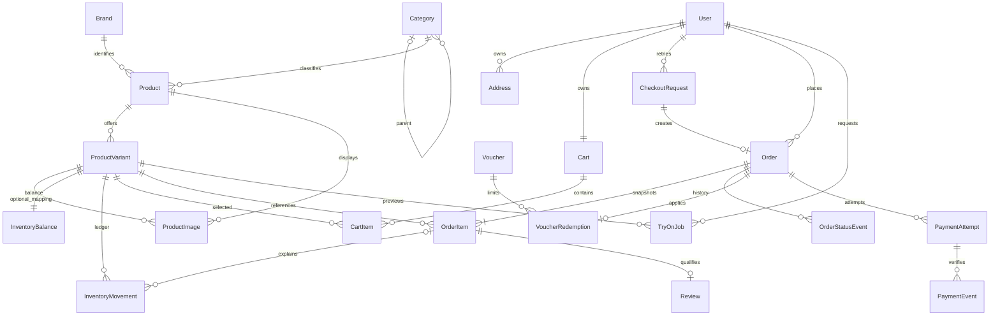

# Database design — PostgreSQL

Ngày 16/11/2026. Thiết kế cho review/QHS-002, QHS-014, không phải migration đã chạy. Theo [architecture](ARCHITECTURE_FINAL.md); stock timing/state/money/voucher/review/retention còn chịu gate DEC-003/008/009/010/015/005. Không mặc định các gate này đã approved.

## 1. Quy ước

PK UUID cho business entities, Django auth/group/permission/session giữ loại framework quy định. FK cùng loại PK đích, NOT NULL trừ khi ghi `?`. Tất cả entity có created_at, entity mutable có updated_at, dùng timestamptz UTC. Text enum có CHECK, Django choices và API enum đồng bộ. Tên bảng theo `<app>_<model>` chuẩn ORM; tên domain trong bảng dưới ánh xạ trực tiếp model, không tạo DB riêng cho mỗi app.

Money numeric(14,2), API decimal string, không float. Currency char(3) chung một order; đề xuất VND nhưng DEC-009 cần chốt currency/precision/rounding. Nếu VND chốt thì check giá trị tiền nguyên theo đơn vị đồng. Chưa gán phí ship/tax hoặc giá sale mẫu vào runtime. Qty/delta integer; qty>0, stock>=0. Index FK Django, thêm composite theo truy vấn dưới, không index mọi cột text.

Product, Category, Brand, Voucher và Review có thêm `version integer >=1` cho optimistic concurrency trong admin API; ProductVariant dùng `revision` tương đương. PATCH/moderation kiểm expected_version dưới lock và tăng version, không chỉ so ở frontend. Catalog V1 một currency theo policy; thay currency của catalog cần migration/policy review, không cho trộn line currency trong một order.

**Product** là nội dung model hàng (ví dụ một mẫu giày); **ProductVariant** là đơn vị bán theo product/size/color; **SKU** là mã unique của một variant, không phải bảng độc lập hay Product ID. Không dùng SKU làm FK vì mã có thể cần đổi theo quy trình; OrderItem vẫn giữ sku_snapshot. Một variant có một InventoryBalance, không sao chép stock ở Product và Variant; API variant.stock_qty đọc balance.

## 2. ERD logic

Các quan hệ Cart, balance và OrderItem tối thiểu một là invariant tạo bằng service/transaction, FK một mình không ép một Product phải có variant hay Order phải có line. P1/P2 trong ERD là thiết kế, không yêu cầu tạo toàn bộ migration V1.

## 3. Identity/catalog/cart

| Model | Cột chính | FK/delete và constraints |
|---|---|---|
| User | id, email, password (hash framework), display_name, phone?, is_active, is_staff, is_superuser | Custom user trước migration đầu; email lower/trim tại boundary, unique lower(email) DB; không tự lower password. Groups/permissions Django, không role string client-controlled |
| Address | id, user_id, receiver, phone, street, area JSON có schema/version, is_default | user CASCADE khi được phép xóa user; partial unique(user) WHERE is_default. Lock user trước set default/checkout. Địa giới chọn DEC-014; không FK đơn tới địa chỉ live |
| Category | id, name, slug, parent_id?, is_active | slug unique; parent PROTECT; check parent!=self; cycle nhiều cấp kiểm dưới khóa serialize chỉnh cây (khóa root quản trị chung), không chỉ check SQL self |
| Brand | id, name, slug, is_active | slug unique; logo nếu được duyệt đi qua public media validation |
| Product | id, category_id, brand_id, name, slug, description, status | category/brand PROTECT, slug unique, status draft/published/archived; publish cần variant active + ảnh hợp lệ do service |
| ProductVariant | id, product_id, sku, size, color, unit_price, is_active, revision | product PROTECT, SKU canonical uppercase trim unique; size/color normalized nonempty, unique(product,size,color); unit_price>=0; revision tăng khi thay giá/visibility |
| ProductImage | id, product_id, variant_id?, storage_key, alt_text, sort_order | product CASCADE chỉ khi product chưa dùng và được phép xóa; variant PROTECT; sort>=0. Variant phải thuộc product: service validation trong transaction, không CHECK cross-table |
| Cart | id, user_id, revision | user OneToOne CASCADE; tạo lazy nếu chưa có; revision>=0, mutation khóa user rồi cart |
| CartItem | id, cart_id, variant_id, qty | cart CASCADE, variant PROTECT; unique(cart,variant), qty>0; không lưu đơn giá như authority; thêm cùng variant là tăng qty theo API |

Không hard-delete product/variant đã được tham chiếu; archive/disable. User có Order dùng PROTECT; quy trình yêu cầu xóa dữ liệu thật cần retention/anonymization riêng, không hứa CASCADE mọi PII.

## 4. Orders và inventory

| Model | Cột chính | FK/delete và constraints |
|---|---|---|
| CheckoutRequest | id, user_id, key varchar(128), request_hash char(64), order_id?, created_at | user PROTECT; unique(user,key), order OneToOne PROTECT. Insert và link cùng transaction; không để claim pending commit; giữ cùng tuổi thọ order, không purge key làm replay tạo order mới |
| Order | id, number, user_id, status, payment_method, payment_status, currency, subtotal, discount, shipping, total, address_snapshot JSON, policy_version, version, delivered_at?, paid_at? | user PROTECT; number unique server-generated; checks tiền>=0, discount<=subtotal, total=subtotal-discount+shipping theo policy demo không thuế riêng; status/payment enum; version>=1 |
| OrderItem | id, order_id, variant_id, product_name_snapshot, sku_snapshot, size_snapshot, color_snapshot, unit_price, qty, line_subtotal, allocated_discount | order/variant PROTECT; unique(order,variant); qty>0, price>=0, line_subtotal=price*qty, 0<=allocated_discount<=line_subtotal; service đối soát sum lines với order |
| OrderStatusEvent | id, order_id, from_status?, to_status, actor_id?, reason?, version | order PROTECT, actor SET_NULL; unique(order,version); append-only; JSON API không writable lịch sử |
| InventoryBalance | variant_id PK/FK, stock_qty, updated_at | variant PROTECT, stock_qty>=0; chỉ inventory service thay đổi dưới lock; số dư đầu cũng phải có opening movement |
| InventoryMovement | id, variant_id, order_item_id?, actor_id?, kind, delta, before_qty, after_qty, reason, operation_key, request_hash | variant/order_item PROTECT; actor SET_NULL; delta!=0, before/after>=0, after=before+delta; kind opening/adjustment/checkout/cancel_return; checkout delta<0, return delta>0; partial unique(order_item,kind) cho checkout/return; operation_key unique toàn bảng |

Movement operation_key server sinh từ item/kind với order; admin adjustment dùng actor + idempotency key và canonical hash. Cùng key khác payload 409. Null order_item chỉ cho opening/adjustment; checkout/return bắt buộc có item và đúng variant. Cross-table quantity, sums và reference consistency kiểm trong service, test và reconciliation, không tuyên bố CHECK làm được mọi invariant.

`stock_qty = sum(delta)` kể từ opening trong cùng transaction history. Quantity vật lý, hàng hỏng, reservation riêng và nhiều kho chưa nằm V1. Nếu DEC-003 chọn reserve thay deduct: phải thêm reservation/available semantics và sửa movement types, không chỉ đổi tên field.

State enums tham chiếu architecture, còn chờ business approval. Order.payment_method là cod/sandbox; payment_status là unpaid/pending/paid/failed/refund_pending/refunded/reconcile_required (P0 COD chỉ unpaid/paid khi policy cho phép). paid_at chỉ do hành động thu tiền hoặc verified payment, không suy từ delivered_at. Address snapshot có receiver/phone/street/area lúc đặt, không là reference động; OrderItem luôn lưu hiển thị dù archive variant. Hạn lưu PII đơn cần quyết định riêng trước khách thật; không dùng TTL ảnh xóa hóa đơn.

## 5. Voucher, review — P2 chưa bật

| Model | Cột/quan hệ | Constraints và transaction |
|---|---|---|
| Voucher | id, code, discount_type, value, max_discount?, min_subtotal, starts_at, ends_at, total_limit?, per_user_limit?, used_count, is_active | unique uppercase code; percent hoặc fixed; value>0, percent<=100, starts<ends, limits>0 khi có; used_count>=0 và <=total_limit; policy stack/cancel hoàn lượt dùng chờ DEC-015 |
| VoucherRedemption | id, voucher_id, user_id, order_id, discount_amount, state | các FK PROTECT, order OneToOne (một voucher/order tham chiếu); state applied/released; amount>=0. Lock voucher khi kiểm quota và redemption, không chỉ đếm ngoài transaction |
| Review | id, user_id, order_item_id, rating, body, status, moderation_reason?, moderated_by? | user/item PROTECT, moderator SET_NULL; order_item OneToOne, rating 1…5, status visible/hidden; item phải thuộc user, order đủ điều kiện chốt; retry/edit theo policy, không cho client chọn verified |

Model thiết kế cho một review/item; nếu muốn một review/product/user thay đổi uniqueness trước migration. Review ảnh là scope mở, chưa có upload mặc định. Voucher discount được allocate vào items theo rule rounding đã duyệt để reports/refund không lệch; service tổng allocated_discount=order.discount.

## 6. TryOnJob và audit

TryOnJob: UUID PK, user FK PROTECT, variant FK PROTECT; status queued/processing/succeeded/failed/canceled/expired/deleted; input_key?, output_key?, garment_key snapshot?, model_id/version?, pipeline_category, consent_version/consent_at, expires_at, started_at?, finished_at?, error_code?, attempt_count>=0, lease_token?, lease_until?, delete_requested_at?, purge_completed_at?. Keys là private storage references, không public URL; garment asset có quyền được snapshot/pin để edit ảnh sản phẩm không thay input job đang chạy.

CHECK succeeded cần output_key và finished_at; processing cần lease/token; expires_at>created_at; deleted cần delete_requested_at. Terminal canceled/expired/deleted không publish output. Xóa logic và purge vật lý là hai trạng thái khác nhau; lưu minimal tombstone không chứa ảnh/EXIF/prompt nhạy cảm. Index(status,lease_until), (expires_at,purge_completed_at), (user,created_at DESC). Job retry claim bằng compare-and-set token, worker cũ không ghi thành công khi lease mới/ảnh đã bị xóa.

AuditEvent: id, actor FK SET_NULL, action, object_type/object_id, request_id, timestamp, redacted_changes JSON. Không FK generic buộc xóa ledger; chỉ append bằng app, không CRUD qua public API. Không ghi password/token/input ảnh/địa chỉ đầy đủ vào audit. DB privilege cho app/worker hạn chế; audit bất biến ở app không tự có nghĩa chống sửa bởi DB superuser.

## 7. Payment và email — P2

PaymentAttempt: id, order FK PROTECT, provider, provider_reference?, amount, currency, status pending/paid/failed/canceled/expired/reconcile_required, idempotency_key, expires_at?, paid_at?. Unique(provider,provider_reference) khi reference tồn tại, unique(order,idempotency_key); amount>=0. PaymentEvent: id, attempt FK PROTECT, provider,event_id,payload_hash,received_at,processed_at?,result; unique(provider,event_id). Không lưu PAN/CVV; chỉ giữ raw webhook nếu retention/redaction được duyệt.

EmailOutbox chỉ khi FR-BG-001 triển khai: id, order FK PROTECT, event_type, order_version, deduplication_key unique, status/attempts/next_attempt_at; tối thiểu PII, không dựa queue broker làm bản ghi duy nhất. Payment/expiry locks tuân architecture và DEC-015.

## 8. Index, migration và AC

Index public products(status,category), variant(product,is_active), orders(user,created_at DESC), orders(status,created_at), movements(variant,created_at), events(order,version), review(status,created_at); search nhỏ dùng PostgreSQL icontains trước, chỉ thêm trigram khi query plan chứng minh cần. Dashboard tính từ snapshots và policy DEC-012; không giữ bảng counter doanh thu dễ drift.

DB-AC1 / QHS-009/014: unique/check/FK/delete behavior được migration/integration test. DB-AC2 / QHS-017/020: concurrency PostgreSQL thật, invariants balance/ledger và snapshots. DB-AC3 / QHS-028/029: ownership/private keys/lease/purge đúng state. P2 có regression riêng theo FR khi bật. **Hiện chưa chạy** migration/tests; không tuyên bố schema đã valid trên DB thực.
